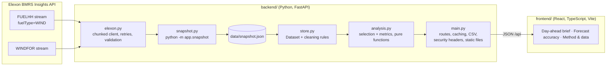

# Wind Forecast Monitor

A web app for the team at a UK energy utility that buys power in the GB day-ahead market. For each purchase decision made in **January 2026**, it shows:

1. **The wind forecast that was available at the moment of purchase.** This is the latest Elexon `WINDFOR` run published before the day-ahead cutoff on D-1, compared with metered `FUELHH` wind output.
2. **How far that forecast can be trusted.** MAE, RMSE, bias and WAPE, error percentiles, error by lead time, hour and day, plus a bias correction that uses only data available at decision time.

**Live app (frontend, Vercel):** https://q7m2vx.vercel.app
**API (Render):** `[PENDING: new Render URL after the service is recreated for the renamed repo]` (health: `/api/health`, docs: `/docs`)

> Status 25 Oct 2026: the frontend is live at https://q7m2vx.vercel.app (all page links open). The backend is being recreated on Render after the repository rename, so the pages cannot load data until the new API URL is set in Vercel. See [Deployment](#deployment).

**Demo video:** `[PLACEHOLDER: unlisted YouTube URL, to be added after recording]`

The scope is Elexon BMRS national wind only. Built with React + TypeScript (frontend) and Python FastAPI (backend), with Docker.

---

## The business problem

The utility must buy tomorrow's electricity before 09:20 UK time today. Wind generation is weather-dependent, so the desk relies on the wind forecast it has at that moment. The tool answers two questions:
- What did that forecast say?
- How wrong does it tend to be?

It measures **wind forecast error**. That is not the volume of power to buy, because demand and prices are outside this project's scope.

## Key findings (09:20 cutoff, delivery days 2 Jan – 1 Feb 2026, 744 matched hours)

| Measure | Value |
|---|---|
| Mean absolute error | 2,022 MW (17.9% of mean wind output; WAPE 17.9%) |
| Mean bias (forecast − actual) | +1,746 MW. The forecast was above actual in 84.7% of hours |
| P90 over-forecast | 4,154 MW |
| MAE after trailing 7-day bias correction | 1,606 MW (−20.6%), using only data known at the cutoff |
| Worst delivery day | 28 Jan 2026: forecast 267.2 GWh, actual 138.2 GWh |

The 09:30 WINDFOR run arrives **10 minutes after** the 09:20 gate closure, so day-ahead decisions effectively rest on the 07:30 run. All figures are computed by this code from the committed snapshot and can be reproduced from `GET /api/accuracy` and `GET /api/overview?date=2026-01-28`; the tests assert their structure and invariants (744 matched hours, bias correction lowers MAE).

---

## Features

| Page (route) | What it shows |
|---|---|
| **Day-ahead brief** (`/`) | Pick a delivery day and a decision cutoff. It shows: the decision context (cutoff, the forecast run used and its lead, the next run and whether it was too late); what was known at the cutoff vs observed after delivery; the forecast vs actual chart with optional P10–P90 range, bias-adjusted and last-before-delivery overlays; the largest hourly errors; every revision of the day's forecast; and the **forecast history of any single delivery hour** across runs. Includes a CSV export of the hourly table. |
| **Forecast accuracy** (`/accuracy`) | Accuracy at the cutoff or at a fixed lead time: MAE, RMSE, bias, WAPE, P90/P10, matched hours. Findings are generated by stated rules. It also has metric definitions, daily mean error (with a table view; click a day to open it), error vs lead time, lead-time buckets, error distribution, error by hour, and a forecast-vs-actual scatter. Includes a CSV export. |
| **Method & data** (`/method`) | Method and limitations, a backend data-quality report (coverage, cleaning counts, retrieval time and requested ranges), CSV downloads, and a searchable, paginated table of every matched observation. |
| **Privacy** (`/privacy`), **Terms** (`/terms`) | Draft legal pages that describe what the app actually does. Missing owner details are clearly marked. |
| **404** | Any unknown path shows a not-found page with links back. When FastAPI serves the pages (Docker), the HTTP status is 404; on Vercel the SPA rewrite serves the app shell with 200 and the app shows the same page. |

Other behaviour across the app:
- **Time and links:** UK time throughout, with explicit GMT/BST labels. Filters live in the URL (`?date=2026-01-28&cutoff=09:20`), so any view can be shared. Invalid values in a link show an explanation and a reset button.
- **Feedback:** loading skeletons, retryable error states, empty states with recovery actions, and success/failure messages for exports, announced to screen readers.
- **Layout:** works from 320 px to desktop. A mobile drawer menu closes on Escape and manages focus. Wide tables scroll inside their own panel, never the page.

---

## Architecture



- **Snapshot, not live calls.** January 2026 is historical, so the data is fetched once and committed (~0.6 MB). The app is fast and works even when Elexon is down. `python -m app.snapshot` re-fetches it.
- **One selection primitive.** WINDFOR is stored as *runs* (one per `publishTime`). `Dataset.latest_run_at(t)` is a binary search over publish times, and both "latest at cutoff" and "fixed lead time" are built on it.
- **Pure analytics.** `analysis.py` does no I/O. Routes only validate parameters and pick cached results. Default results are computed at startup.

| Layer | Choices |
|---|---|
| Frontend | React 18, TypeScript (strict), Vite 5, Recharts, plain CSS design tokens, system font stack, inline SVG icons. No UI framework and no router dependency. |
| Backend | Python 3.10+, FastAPI, Pydantic response models, httpx, python-dotenv |
| Quality | pytest (63 tests), ruff (lint and format), `tsc` |
| Packaging | Docker (multi-stage) and Docker Compose |

## Repository layout

```
.
├── README.md
├── .gitignore                  ignores .env files, node_modules, builds, virtualenvs, caches
├── backend/
│   ├── app/
│   │   ├── config.py           study window, 09:20 default cutoff, env settings (.env)
│   │   ├── elexon.py           Elexon client: 7-day chunks, retry on 429/5xx, response validation
│   │   ├── store.py            Dataset/ForecastRun model and cleaning rules (with counts)
│   │   ├── snapshot.py         rebuilds data/snapshot.json from Elexon
│   │   ├── analysis.py         forecast selection, matching, metrics, findings, data quality
│   │   ├── schemas.py          Pydantic response models (shown at /docs)
│   │   └── main.py             routes, caching, CSV export, gzip, security headers, SPA + 404
│   ├── data/snapshot.json      committed Elexon data (Jan 2026 plus 10 days of December warm-up)
│   ├── tests/                  test_analysis, test_store, test_elexon, test_api
│   ├── .env.example            backend settings template
│   ├── Dockerfile              Node build of the frontend, then Python runtime (build context = repo root)
│   ├── Dockerfile.dockerignore
│   ├── docker-compose.yml      `docker compose up --build -d` serves the app on :8000
│   └── requirements.txt / requirements-dev.txt / pyproject.toml
└── frontend/
    ├── public/                 favicon.svg, favicon-32.png, apple-touch-icon.png, og-image.png
    ├── src/
    │   ├── App.tsx             shell: sidebar, mobile menu, data status, footer, page switch
    │   ├── router.ts           minimal path router (history API), query-string filters
    │   ├── seo.ts              per-route title, description, canonical and Open Graph tags
    │   ├── api.ts              typed API client, user-facing errors, CSV download
    │   ├── format.ts           MW/GWh formatting, UK time and GMT/BST labels
    │   ├── styles.css          design system (tokens, layout, tables, charts, responsive)
    │   ├── components/         common.tsx (filters, measurements, states, icons), feedback.tsx (messages)
    │   ├── views/              DayView, AccuracyView, MethodView
    │   └── pages/              NotFound, Legal (Privacy, Terms)
    ├── index.html              default metadata, Open Graph/Twitter tags, icons
    ├── package.json / package-lock.json / tsconfig.json
    ├── vite.config.ts          dev proxy, chunk splitting, robots.txt / sitemap.xml generation
    ├── vercel.json             Vercel: SPA rewrite for page links, security and cache headers
    └── .env.example            frontend settings template
```

---

## Running it

### Without Docker (two terminals)

```powershell
# Terminal 1: backend on :8000
cd backend
python -m venv .venv
.venv\Scripts\activate            # macOS/Linux: source .venv/bin/activate
pip install -r requirements-dev.txt
copy .env.example .env            # macOS/Linux: cp .env.example .env
uvicorn app.main:app --reload --port 8000
```

```powershell
# Terminal 2: frontend on :5173
cd frontend
copy .env.example .env
npm install
npm run dev
```

Open http://localhost:5173. API docs are at http://localhost:8000/docs.

### With Docker (Windows 11 + Docker Desktop, WSL 2)

**Prerequisites:** Docker Desktop running, and an internet connection for the first build, which pulls `node:22-alpine` and `python:3.12-slim`.

**What runs:** one container (`wind-forecast-monitor-app-1`, image `wind-forecast-monitor:local`, about 240 MB).
- A Node stage builds the React app.
- The Python stage serves both the API and the built pages on the same origin. The browser calls `/api` relatively, so no backend hostname is needed.
- Health check: `/api/health`.
- It runs as a non-root user.
- No `.env` file is copied into the image.

```powershell
cd backend
docker compose up --build -d        # build and start in the background
docker compose ps                   # STATUS should become "(healthy)" within ~30 s
```

| URL | What |
|---|---|
| http://localhost:8000 | the app |
| http://localhost:8000/api/health | health check, `{"status":"ok",…}` |
| http://localhost:8000/docs | interactive API docs |

Useful commands, run from `backend/`:

```powershell
docker compose logs -f --tail=100   # follow the logs
docker compose up --build -d        # rebuild after code changes
docker compose restart              # restart without rebuilding
docker compose down                 # stop and remove the container
docker compose config               # validate the compose file
```

**Port 8000 already in use?** Choose another host port. The container still listens on 8000 inside:

```powershell
$env:APP_PORT=8080; docker compose up --build -d     # then open http://localhost:8080
```

**Verified on Windows 11** (Docker Desktop, Engine 29.9.2, Compose v5.6.1, WSL 2):
- the image builds in about 4 minutes on the first run, faster from cache;
- the container reports `healthy`, and every page and API route answers;
- the browser workflow loads real data with no console errors;
- if the API is unreachable, the pages show an error with a working Retry.

## Configuration

Copy each `.env.example` to `.env`. Real `.env` files are git-ignored and excluded from the Docker build.

**backend/.env** (server-side only)

| Variable | Default | Meaning |
|---|---|---|
| `PORT` | `8000` | Port inside the Docker container |
| `CORS_ORIGINS` | `*` (example: `https://your-frontend.vercel.app,http://localhost:5173`) | Comma-separated allowed origins. Set it to the frontend URL in production when hosting separately |
| `SNAPSHOT_PATH` | `data/snapshot.json` | Data file, relative to `backend/` |
| `STATIC_DIR` | `static` | Built frontend to serve, if present |
| `LOG_LEVEL` | `INFO` | Python log level |
| `ENABLE_HSTS` | `false` | Send `Strict-Transport-Security`. Enable only once the site is served over HTTPS |

**frontend/.env.** These values are **public**: anything starting with `VITE_` is compiled into the browser bundle, so never put secrets here.

| Variable | Default | Meaning |
|---|---|---|
| `VITE_API_BASE_URL` | _(empty)_ | API origin when the frontend is hosted separately. Empty means same origin |
| `VITE_PROXY_TARGET` | `http://127.0.0.1:8000` | Dev server only: where `/api` is proxied |
| `VITE_SITE_URL` | _(empty)_ (example: `https://your-frontend.vercel.app`) | Production URL. Enables canonical links, absolute OG image URLs and `sitemap.xml` |
| `VITE_CONTACT_EMAIL` | _(empty)_ | Shown as a `mailto:` link in the footer and legal pages when set |
| `VITE_OPERATOR_NAME` | _(empty)_ | Operator's legal name, shown on the legal pages when set |

No credentials are needed: the Elexon endpoints used are public. A source audit found no secrets in the code or env files.

---

## Data, selection and metrics

### Elexon sources

| Dataset | Endpoint | Fields used |
|---|---|---|
| Actual generation | [`FUELHH/stream`](https://bmrs.elexon.co.uk/api-documentation/endpoint/datasets/FUELHH/stream), `fuelType=WIND`, by settlement date | `fuelType`, `startTime`, `generation` (MW, half-hourly), `publishTime` (to resolve duplicates) |
| Wind forecast | [`WINDFOR/stream`](https://bmrs.elexon.co.uk/api-documentation/endpoint/datasets/WINDFOR/stream), by publish time | `startTime`, `publishTime`, `generation` (MW, hourly) |

Both endpoints were queried live while building the snapshot; the requested ranges and retrieval time are shown on the Method & data page.

- **Publication pattern (observed):** WINDFOR runs come 8 times a day (02:30, 04:30, 07:30, 09:30, 11:30, 15:30, 18:30, 22:30 UTC), hourly, up to about 66 h ahead.
- **No pagination:** the stream endpoints return a plain JSON array, so the client requests 7-day chunks.

**Cleaning rules** (`store.py`; the counts appear on Method & data):
- **Rejected rows:** missing or invalid timestamps, and generation that is missing, non-numeric, NaN or negative.
- **Duplicate actuals:** the latest `publishTime` wins; on a tie, the last row wins.
- **Duplicate forecast points:** the last row wins.
- **Restated hours:** WINDFOR rows whose `startTime` is before their `publishTime` are dropped (5,281 in this snapshot), because each run restates hours that have already passed.

### Forecast selection and timestamps

- **Study window.** "Decisions made in January 2026" means decisions on 1–31 Jan, so delivery days run from **2 Jan to 1 Feb 2026**.
- **Decision cutoff (assumption, configurable).** The default is **09:20 UK time on D-1**, gate closure of the GB hourly day-ahead auctions (N2EX / EPEX GB). This is a documented assumption, not a universal rule. Presets are 09:20, 11:00 and 15:30 (EPEX half-hourly auction), and any time can be entered. A later cutoff sees later runs (MAE 2,022 MW at 09:20 vs 1,859 MW at 15:30).
- **Selection rule.** For delivery day D, use the run with the greatest `publishTime` ≤ cutoff. Runs published after the cutoff are never used.
- **Fixed-lead mode.** For each hour T, use the latest run with `publishTime` ≤ T − N hours.
- **Timezones.** All arithmetic uses timezone-aware UTC; `Z` timestamps are parsed as UTC. Delivery days and cutoffs are UK local times via `zoneinfo`, so BST and 23/25-hour clock-change days are handled (tested). The UI labels every time GMT or BST.
- **Interval semantics.** `startTime` is the start of the delivery interval: 30 min for FUELHH, 1 h for WINDFOR. An hourly forecast for T is compared with the FUELHH half-hour starting at T. Hours missing either value are excluded and listed as unmatched; nothing is filled with zeros.
- **Availability assumption.** `publishTime` is treated as the moment a run became available. Any delivery delay to the desk is not modelled.

### Metrics

Error = **forecast − actual** in MW per matched hour. A positive error means an over-forecast: wind came in below the forecast.

| Metric | Definition |
|---|---|
| MAE | mean(\|error\|), MW |
| RMSE | √mean(error²), MW |
| Bias | mean(error), MW |
| WAPE | Σ\|error\| ÷ Σ actual × 100; not reported when Σ actual = 0 |
| P90 over-forecast / P10 | 90th / 10th percentile of the signed error (linear interpolation) |
| P10–P90 range (day chart, optional) | the day's forecast shifted by the error percentiles of all **other** delivery days (leave-one-day-out) |
| Bias-adjusted forecast (optional) | forecast − mean error of delivery days D-8 … D-2, which are fully settled before D-1's cutoff |
| Energy | GWh = Σ hourly forecast MW × 1 h ÷ 1000; Σ half-hourly actual MW × 0.5 h ÷ 1000 |

---

## API

| Endpoint | Purpose |
|---|---|
| `GET /api/health` | status, row counts, snapshot time |
| `GET /api/meta` | study window, default cutoff, observed publish schedule |
| `GET /api/overview?date=2026-01-15&cutoff=09:20` | day view: decision run, actuals, overlays, revisions, plus month metrics |
| `GET /api/forecasts?date=2026-01-15&published=2026-01-14T15:30:00Z&hour_from=6&hour_to=18` | all runs for a day, and an hourly table for one run |
| `GET /api/forecasts/revisions?start_time=2026-01-15T12:00:00Z&cutoff=09:20` | how one delivery hour's forecast changed across runs |
| `GET /api/accuracy?mode=decision&cutoff=09:20` or `?mode=horizon&hours=24` | metrics, daily, hourly, histogram, scatter, lead buckets, findings |
| `GET /api/horizon-curve` | MAE, bias and P90 for lead times 0–48 h |
| `GET /api/actuals`, `/api/forecast-records`, `/api/matched` | paginated records: `date_from`, `date_to`, `search` (≤ 64 chars), `page`, `page_size` (≤ 500) |
| `GET /api/data-quality?cutoff=09:20` | coverage, unmatched hours, cleaning counts, retrieval info |
| `GET /api/export?dataset=matched\|actuals\|forecasts\|explorer&…` | CSV with the same filters as the matching table |

- **Errors:** invalid parameters return 422, dates outside the window return 404, unknown `/api/*` paths return a JSON 404, and unexpected errors return a generic 500 with details only in the server log.
- **Docs:** OpenAPI documentation is at `/docs`.

## Security, privacy and SEO

- **Headers.**
  - **FastAPI (Render API, Docker):** every response carries `X-Content-Type-Options`, `Referrer-Policy`, `X-Frame-Options` and `Permissions-Policy`. HTML it serves also gets a strict `Content-Security-Policy` (self-hosted assets only, no inline scripts). `Strict-Transport-Security` is sent only when `ENABLE_HSTS=true`; it is on for Render.
  - **Vercel:** `frontend/vercel.json` sets the same four headers and a one-year cache on `/assets/*`; Vercel serves HTTPS itself. No CSP is set on Vercel.
- **HTTPS.** The app makes no absolute `http://` requests, so there is no mixed content once it is served over HTTPS. The Docker image runs uvicorn with `--proxy-headers`, which trusts `X-Forwarded-*` only from `FORWARDED_ALLOW_IPS` (default `127.0.0.1`). Set that variable to your proxy's address when deploying. **Verified on 25 Oct 2026:** the Vercel frontend redirects `http://` to `https://`, and the Render API is served over HTTPS with `Strict-Transport-Security`.
- **Caching and compression.** Fingerprinted `/assets/*` files are cached for a year; HTML is `no-cache`; responses are gzip-compressed.
- **Privacy and cookies.** The app sets **no cookies**, uses **no browser storage**, loads **no third-party scripts or fonts**, and has **no analytics**. A consent banner would therefore be misleading and is not shown. To add analytics later:
  1. pick a provider;
  2. load it only after consent, via a banner with accept, reject and a way to revisit the choice;
  3. update the Privacy page.
- **Legal pages are drafts.** `/privacy` and `/terms` describe the actual behaviour. Operator name, contact, hosting/log retention, governing law and liability wording are marked **"Owner to complete"** and need owner and legal review.
- **SEO.** This is an analytical tool with modest search value, so the approach is proportionate:
  - unique titles and descriptions per route, Open Graph/Twitter tags, a favicon set and a 1200×630 social image (a real product crop);
  - `robots.txt` that disallows `/api/`;
  - with `VITE_SITE_URL` set, canonical URLs and `sitemap.xml`. No domain is invented.
  - The app is client-rendered, so crawlers that do not run JavaScript (most social previews) see the defaults in `index.html`; per-page previews would need prerendering.

## Testing and verification (actual results)

```powershell
cd backend
pytest -q                 # 63 passed
ruff check .              # All checks passed
ruff format --check .     # all files formatted

cd ../frontend
npm run build             # tsc (strict) + vite build: succeeds
```

The tests cover:
- the latest run before the cutoff is selected, and later runs are excluded;
- multiple revisions per hour are handled;
- forecasts are matched to actuals by `startTime`, and missing actuals are excluded;
- MAE, RMSE, bias and WAPE are correct, including WAPE with a zero denominator;
- duplicate and invalid rows are handled deterministically;
- the January window and BST/clock-change days are correct;
- the Elexon client handles 429 retries, 5xx errors, network errors and malformed responses (mocked);
- API responses are correct for empty data, and CSV exports are correct;
- security headers, unknown API routes, search length limits, and SPA routes with a real 404 status.

Browser checks used headless Microsoft Edge, driven with real mouse, keyboard and scroll input via the DevTools protocol. These are emulated widths, not a physical mobile device:
- **Live site (25 Oct 2026, before the rename):** the previous deployment (frontend on Vercel, API on Render) loaded real data in a real browser: every API call returned 200, there were no console errors, and in-app navigation worked.
- **Docker container:** the same workflow ran against http://localhost:8000. Blocking the API showed the error state, and Retry recovered.
- **Tables:** no table needs horizontal scrolling at 320 px or 375 px.
- **Overflow:** every page at 320, 375, 390, 768, 1024 and 1440 px has no page-level horizontal overflow (after fixing one at 320 px).
- **Interaction:** the mobile menu opens, focus moves in, Escape closes it and returns focus, and it closes after navigation. Navigation sets the page title. Filters persist across pages. The CSV export downloads 744 rows and announces success. An empty cutoff shows a field error and the URL is unchanged. The 404 page and its link work. There are no empty or `#` links, external links use `noopener`, and every button has a handler.
- **Lighthouse 12.2.1** (mobile profile, local production build; Lighthouse warned that this CPU is slower than it expects):

  | Page | Performance | Accessibility | Best practices | SEO |
  |---|---|---|---|---|
  | `/` (brief) | 94 | 100 | 100 | 100 |
  | `/accuracy` | 86 | 100 | 100 | 100 |
  | `/method` | 93 | 100 | 100 | 100 |
  | `/privacy` | 94 | 100 | 100 | 100 |

  Measured on 24 Oct 2026 against a local production build, not the deployed site. The `/method` and `/privacy` performance figures were measured before the final optimisations. For the brief and accuracy pages, lazy-mounting below-the-fold charts and fixing a footer layout shift raised performance from 62 and 60. Lighthouse was not re-run after the later table and axis fixes.

## Deployment

**Current status (verified 25 Oct 2026)**

| Part | URL | Status |
|---|---|---|
| Frontend (Vercel) | https://q7m2vx.vercel.app | Live over HTTPS, all page links open. The current build has **no** `VITE_API_BASE_URL`, so it cannot load data yet |
| Backend API (Render) | `[PENDING]` | The previous service was removed; a new one is being created from the renamed repo (`q7m2vx`) |
| Page links (`/accuracy`, `/method`, `/privacy`, `/terms`) | — | Live: `frontend/vercel.json` rewrites them to `/index.html`, and each opens directly. Static files (`/robots.txt`, `/favicon.svg`, `/og-image.png`) are still served as files |

### How it is deployed (for reference)

**Backend: Render web service from this repo**

| Setting | Value |
|---|---|
| Root Directory | `backend` |
| Runtime | Python 3 |
| Build Command | `pip install -r requirements.txt` |
| Start Command | `python -m uvicorn app.main:app --host 0.0.0.0 --port $PORT --proxy-headers --forwarded-allow-ips=*` |
| Health Check Path | `/api/health` |
| Environment | `PYTHON_VERSION=3.12.7`, `CORS_ORIGINS=https://q7m2vx.vercel.app`, `ENABLE_HSTS=true`, `LOG_LEVEL=INFO` |

- Use `python -m uvicorn` rather than plain `uvicorn`, so the start step finds the packages the build installed.
- On the free plan the service sleeps when idle; the first request afterwards takes about 30–60 s.

**Frontend: Vercel project with Root Directory `frontend`**
- Environment variables (Production): `VITE_API_BASE_URL=<Render URL>` and `VITE_SITE_URL=https://q7m2vx.vercel.app`. Vercel reads its own settings, not the git-ignored `.env`, and the values take effect on the next build.
- `frontend/vercel.json` provides the SPA rewrite, security headers and asset caching.

**Alternative: a single service.** Build `backend/Dockerfile` with the repo root as context. It serves the API and the pages on `$PORT`, with page routes, real 404 status and the CSP handled by FastAPI. Set `ENABLE_HSTS=true` when it is behind HTTPS.

## Limitations

- **Over-forecast cause unconfirmed.** January showed a persistent over-forecast. A plausible contributor is curtailment: FUELHH is metered output after constraint actions, while WINDFOR forecasts available output. This is a hypothesis to check with the client.
- **Short sample.** One month of data gives indicative percentiles, not a seasonal calibration.
- **Narrow scope.** National wind only: no demand, price, embedded solar or regional data.

## Use of AI tools

This project was built with help from **Claude Code (Anthropic)**. It was used for:
- exploring the Elexon API;
- writing and refactoring the backend and frontend;
- writing tests;
- browser-based QA scripts and reviewing screenshots;
- drafting the documentation and demo script.

Design decisions, figures and code were checked by running the tests, the type checker, the production build and automated browser checks.
